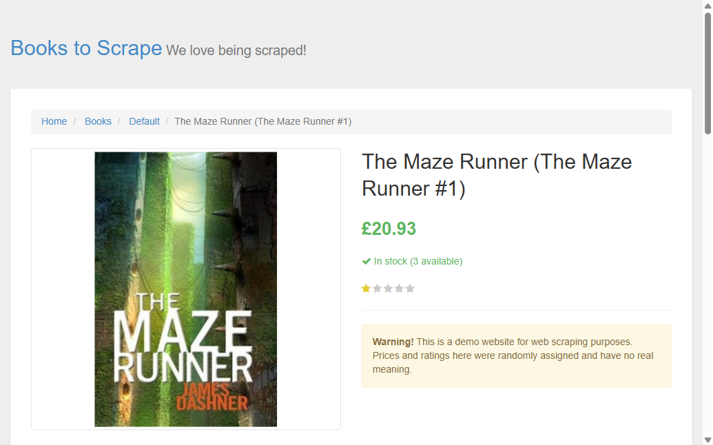

# Playwright MCP ile canlı doğrulama

**Araç:** Playwright MCP (Claude uygulamasının Playwright eklentisi, bilgisayarımdaki tarayıcı).
**Yöntem:** `validate.py` dosyasının `random_state=42` ile seçtiği 5 rastgele kitap ve bilinen kayıt ("A Light in the Attic") canlı sitede liste sayfalarından bulundu, detay sayfaları açıldı (istekler arası 0.6 sn bekleme). Okunan değerler `kitaplar.csv` ile karşılaştırıldı.
**Tarih:** 23.10.2026

| Kitap | Site: fiyat / puan / stok / kategori | CSV: fiyat / puan / stok_adedi / kategori | Sonuç |
|---|---|---|---|
| A Light in the Attic | £51.77 / Three / In stock (22 available) / Poetry | 51.77 / 3 / 22 / Poetry | ✅ |
| Naturally Lean: 125 Nourishing Gluten-Free, Plant-Based Recipes--All Under 300 Calories | £11.38 / Five / In stock (7 available) / Food and Drink | 11.38 / 5 / 7 / Food and Drink | ✅ |
| The Maze Runner (The Maze Runner #1) | £20.93 / One / In stock (3 available) / Default | 20.93 / 1 / 3 / Default | ✅ |
| The Lean Startup: How Today's Entrepreneurs Use Continuous Innovation to Create Radically Successful Businesses | £33.92 / Three / In stock (3 available) / Business | 33.92 / 3 / 3 / Business | ✅ |
| Shopaholic Ties the Knot (Shopaholic #3) | £48.39 / Five / In stock (4 available) / Womens Fiction | 48.39 / 5 / 4 / Womens Fiction | ✅ |
| Cravings: Recipes for What You Want to Eat | £20.50 / Three / In stock (11 available) / Food and Drink | 20.50 / 3 / 11 / Food and Drink | ✅ |

**Sonuç: 6/6 eşleşti.**



Kullanılan Playwright kodu (`browser_evaluate`), özetle:

```js
// 1-50 arası liste sayfalarında hedef başlıkları bul (her istekten önce 600 ms bekle)
// bulunan detay sayfalarından h1, p.price_color, p.star-rating class'ı,
// p.availability ve breadcrumb'daki 3. öğeyi (kategori) oku
```
